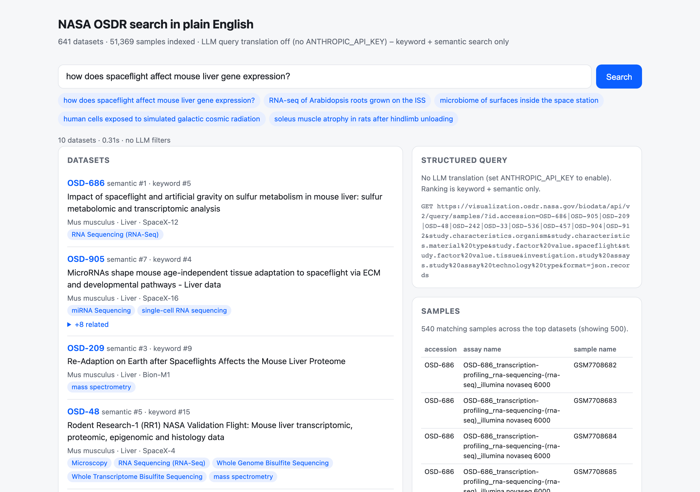
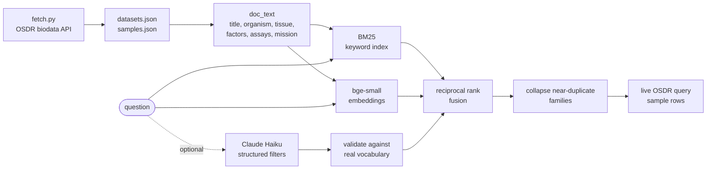

# OSDR plain-English search

Ask a question in plain English and get the matching NASA space biology datasets, plus the sample-level rows behind them, from NASA's Open Science Data Repository.

[](https://github.com/jeheonlee11-create/osdr-search/actions/workflows/ci.yml)



## Why

[NASA OSDR / GeneLab](https://osdr.nasa.gov/bio/) holds about 640 public space biology datasets (51,369 samples) from flown and ground experiments. Finding the right ones normally means knowing its metadata schema: organism, material type, assay technology, mission, factor values. This tool takes a question like "how does spaceflight affect mouse liver gene expression?" and does that mapping for you, without letting a language model invent field values that do not exist.

All data comes from the public [OSDR biodata API](https://visualization.osdr.nasa.gov/biodata/api/); this project is not affiliated with NASA.

## How it works



1. **Corpus.** `fetch.py` downloads every dataset's metadata into `data/datasets.json` (tracked) and the full sample table into `data/samples.json`. `index.py` turns each dataset into one passage (title, organism, tissue, factors, assays, mission, description).
2. **Two retrievers.** `bm25.py` ranks passages by keyword overlap; `index.py` embeds them with `BAAI/bge-small-en-v1.5` (384-d, local ONNX via fastembed) and ranks by cosine similarity. `fusion.py` merges the two top-50 lists with reciprocal rank fusion. `semantic` or `bm25` alone can be selected for evaluation.
3. **Optional LLM filters.** With an `ANTHROPIC_API_KEY`, `llm.py` asks Claude (default `claude-haiku-5-5`, structured outputs) to map the question onto eight OSDR metadata fields. The prompt contains the exact vocabulary from all samples, and `schema.py` validates every returned value against it again; anything that does not resolve is dropped and shown as dropped. Valid filters add one more vote to the fusion, and the model's rewritten query adds half-weight votes next to the original question.
4. **Results.** `families.py` collapses near-duplicate datasets (one study split into per-tissue entries) into one result with "+N related". `search.py` then sends the validated filters and top accessions to the live OSDR `/query/samples/` endpoint (`osdr_api.py`) and `app.py` serves the results through FastAPI and a single-page UI.

## Design decisions and trade-offs

- **Hybrid retrieval over embeddings alone.** Embeddings handle paraphrase ("droppings" for feces); BM25 handles exact tokens the small embedding model under-weights, such as mission codes ("RR-6"). RRF combines them using ranks only, so BM25's unbounded scores and cosine scores in a narrow band never need calibrating against each other.
- **BM25 written in-repo instead of `rank_bm25`.** It is about 50 lines, and 641 short documents need no dependency.
- **Filters as a rank vote, not a score bonus.** The old +0.08 / -0.12 adjustments were hand-set against cosine scores and would swamp RRF scores (~0.03). As one more ranker in the fusion, filters stay on the same scale whatever the retrievers are. Fields missing for more than 25% of datasets (mission, spaceflight condition, tissue) count as unknown rather than as a contradiction when a dataset lacks them; this share is computed from the data.
- **Validate the LLM, do not trust it.** The model only proposes; filter values must exist in the sample table, and a rewritten query that keeps less than a third of the question's content words is ignored. The question itself is always ranked, so a bad rewrite cannot replace it. A small model at low effort is enough for copying values from a list.
- **Fail soft and quietly.** If the LLM or the OSDR API fails, results fall back to retrieval only; the browser gets a fixed message and the details go to the server log. The index stores a fingerprint of the corpus it was built from and refuses to start against a different `datasets.json`.

## Results

Measured 2026-10-24 on the 641-dataset corpus, without the LLM step, by `python -m eval.run_eval`. Scores use the top 10 results as a user sees them (near-duplicate families collapsed). Full method and caveats: [docs/evaluation.md](docs/evaluation.md).

| test set | retriever | queries | recall@5 | MRR@10 | nDCG@10 |
|---|---|---|---|---|---|
| known-item | semantic (previous default) | 50 | 0.932 | 0.870 | 0.887 |
| known-item | BM25 | 50 | 0.944 | 0.911 | 0.923 |
| known-item | hybrid (default) | 50 | 0.928 | 0.920 | 0.912 |
| concept | semantic | 32 | 0.480 | 0.656 | 0.484 |
| concept | BM25 | 32 | 0.455 | 0.688 | 0.450 |
| concept | hybrid | 32 | 0.489 | 0.760 | 0.526 |

- **Known-item** (`eval/known_item.json`): 50 queries that mostly paraphrase one dataset's title, so they test "can it find the dataset I mean". All retrievers are close here; keyword search does well because the queries reuse title words.
- **Concept** (`eval/concept.json`): 32 queries about an organism, tissue, assay, condition or mission, written by an AI assistant from the metadata. Every dataset meeting each query's metadata criteria counts as correct (4 to 38 per query), computed by `eval/build_concept_set.py`. Scores are much lower, which the known-item set hid. Hybrid is best on all three metrics, but by 0.01 to 0.07, close to the noise of 32 queries.
- recall@5 is capped (correct results in the top 5 / min(5, number of correct families)), so 1.0 means the top 5 is as full of correct answers as it can be.

## Limitations and next steps

- The concept set is small, AI-written and labelled from metadata rather than by people; it is a check, not a benchmark. Real user questions with human judgements would be the next step.
- The LLM step has not been evaluated (it needs an API key: `python -m eval.run_eval --llm`). Its vote weights are reasoned defaults, not tuned values.
- Retrieval misses questions that hinge on one exact field value, for example a specific resupply mission: "mouse studies launched on SpaceX CRS-16" finds none of the 31 matching datasets in its top 10. That is what the mission filter is for, which is why evaluating the LLM step matters.
- Fusion can hurt when one retriever is clearly right and the other is lost: for "gut bacteria in mouse droppings", semantic search puts all 8 correct datasets in its top 8, BM25 finds 1, and the fused list shows only 2, because documents that appear in both lists at middling ranks outvote documents that appear in one. Weighting the rankers per query (or a learned re-ranker) is the next thing to try.
- The rate limiter is in memory and keyed by client IP, so it resets on restart and needs a trusted proxy header if deployed behind one.
- The corpus is a snapshot (fetched 2026-10-20); rerun `fetch` and `index` to refresh it.

## Run it

```bash
git clone https://github.com/jeheonlee11-create/osdr-search.git && cd osdr-search
python3.11 -m venv .venv && source .venv/bin/activate
pip install -r requirements.txt
python -m osdr_search.fetch samples   # sample table -> data/samples.json (about 30 MB)
python -m osdr_search.index           # embeddings -> data/index.npz (downloads the 64 MB model once)
cp .env.example .env                  # optional: add ANTHROPIC_API_KEY for the LLM filter step
uvicorn osdr_search.app:app --port 8765
```

Open http://localhost:8765. Without an API key the app runs with keyword + semantic retrieval only. `python -m osdr_search.fetch` refreshes `data/datasets.json` from the API (one request per dataset); after that, rebuild the index.

API: `GET /api/search?q=...&k=10` returns the structured query, validated and dropped filters, ranked datasets with related family members, and sample rows (up to 500). Optional settings: `OSDR_LLM_MODEL`, `OSDR_LLM_TIMEOUT_S`, `OSDR_MAX_QUERY_CHARS` (300), `OSDR_RATE_LIMIT_PER_MIN` (30), `OSDR_CORS_ORIGINS` (unset = same-origin only).

Tests and evaluation:

```bash
pip install -r requirements-dev.txt
ruff check . && pytest            # no data/ files, network, model download or API key needed
python -m eval.run_eval           # needs data/samples.json and data/index.npz
```

## How it was built

Built by Jeheon Lee with AI coding assistants (Claude Code, OpenAI Codex). I set the direction and design, and verified behavior with the tests and evaluation above. The concept test set's queries were written by Claude Code from the metadata, as described in [docs/evaluation.md](docs/evaluation.md).

## License

MIT, see [LICENSE](LICENSE). Data is from NASA's Open Science Data Repository.
